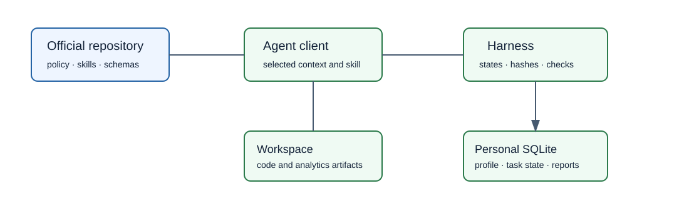

# Agent Operations for Analytics

`implemented` local-first harness for AI-assisted analytics. `experimental` shared-memory laboratory. `proposed` multi-team knowledge plane.

This repository is a portfolio case study about making AI-assisted analytics work traceable: a task has an explicit objective, bounded context, evidence, checks, a status report, and an optional review. It does not claim that a prompt alone enforces security or that an agent is always correct.

## Why this exists

Generation can be cheap while interpreting requirements, finding reliable evidence, and reviewing change remain costly. Structured review can improve review flow in a specific setting: a Google study reports a 25% reduction in median approval time for its design-review intervention; that is not a productivity claim for this project. [Source](https://research.google/pubs/improving-design-reviews-at-google/)

Long context is also not a substitute for retrieval. Research has observed degradation when relevant information is buried in long inputs. This project therefore retrieves narrow, attributable records rather than loading a conversation archive. [Source](https://arxiv.org/abs/2307.03172)

## Status

| Capability | Status | Evidence |
|---|---|---|
| Local workflow, evidence, checks and reports | implemented | Python package and tests |
| SCAN-guided EDA example | implemented | deterministic synthetic example |
| Shared-memory API and PostgreSQL schema | experimental | local laboratory under `experiments/shared-memory` |
| Cross-team sharing and task leases | proposed | contracts and scenarios under `specs/plan-c` |

## Quick start

Requires Python 3.11+. Clone the repository, then use an external personal directory and a separate workspace.

```bash
python3 -m venv .venv
source .venv/bin/activate
python -m pip install .
mkdir -p "$HOME/.agentops-demo" "$HOME/agentops-workspace"
agentops --home "$HOME/.agentops-demo" onboard --source "$PWD" --workspace "$HOME/agentops-workspace" --name "Analyst"
agentops --home "$HOME/.agentops-demo" doctor
agentops --home "$HOME/.agentops-demo" integrate
```

Review the integration preview before using `integrate --apply`. The local workflow does not require an API key. Reviews and behavioral evals are explicit, optional operations that may consume provider quota.

## Architecture



Read [architecture](docs/architecture.md), [orchestration](docs/orchestration.md), [shared memory](docs/shared-memory.md), [security](docs/security.md), [evaluation](docs/evaluation.md), and [references](docs/references.md).

## Portfolio scope and authorship

The author designed the workflow and implementation requirements. AI assistance was used to accelerate drafting and code iteration; every public claim must link to code, test, experiment, or cited source. The repository contains synthetic examples only. It is not a production deployment, certification, or claim of measured organizational savings.

## License and publication

No license is declared in this local preparation snapshot. Add a license only after the author verifies authorship, third-party notices, and the intended public terms.
