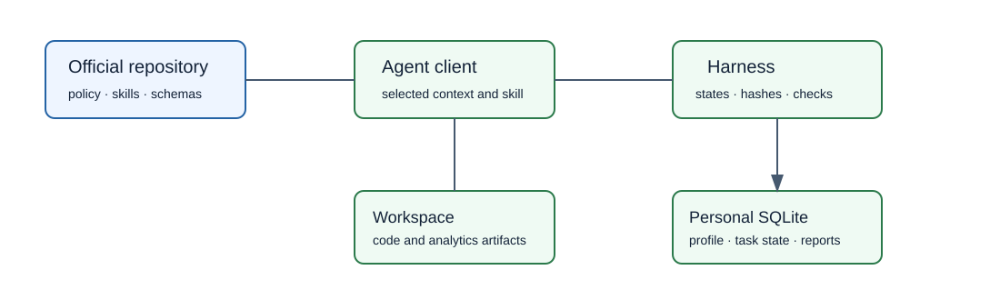
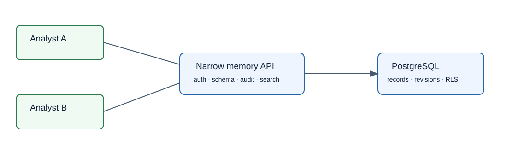
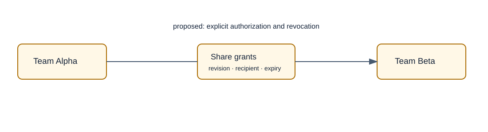

# Architecture and delivery plans

## Plan A — implemented

Plan A is local-first. The official repository distributes policy, skills, schemas and deterministic harness code. A user keeps profile and SQLite state outside the installation and workspace. The harness records task transitions, evidence hashes, declared checks and reports. This is process evidence, not a system-wide security boundary.

## Plan B — experimental laboratory

Plan B adds a shared service for explicit team records. PostgreSQL is selected for the laboratory because it supports transactions, indexes and row-level security. SQLite remains the personal store. The model does not receive direct database credentials: a narrow service authorizes, validates and audits every request.

SHA-256 detects exact changes and supports scoped deduplication. It is neither encryption nor semantic retrieval. The baseline search is metadata plus full-text search; embeddings are deferred until a labelled benchmark shows a gap.

## Plan C — proposed

Plan C adds explicit cross-team grants, revocation, delivery receipts and task leases. It is not implemented. Its contracts show what must be true before an implementation can claim multi-team coordination.

