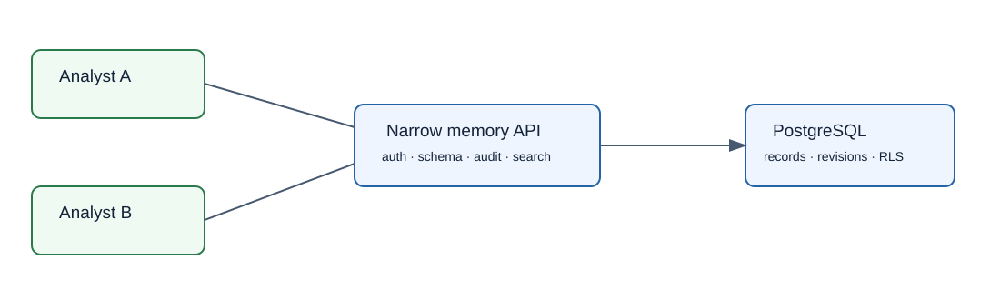

# Shared memory laboratory

The laboratory stores explicit, scoped records rather than conversation transcripts. A record has team/project scope, type, status, current revision, author, timestamps, content hash and evidence status. Each revision preserves title, short summary, structured payload and provenance reference.

Writes are transactional and idempotent per principal/project/key. A reused key with a changed payload returns conflict. Revisions use optimistic concurrency in the proposed contract. Search authorizes the project before evaluating content, filters by scope/type/status, then uses PostgreSQL full-text search over title and summary. The response contains small summaries and revision/hash references; a separate authorized request retrieves detail.

PostgreSQL row-level security is a second access layer, not a replacement for API authorization. Table owners and privileged roles can bypass it, so the application role must not be an owner or `BYPASSRLS`. [PostgreSQL documentation](https://www.postgresql.org/docs/current/ddl-rowsecurity.html)

The laboratory does not publish content to a cloud provider. A future embedding index requires a policy for the embedding provider, model/version tracking, a labelled retrieval benchmark and a new decision record.
